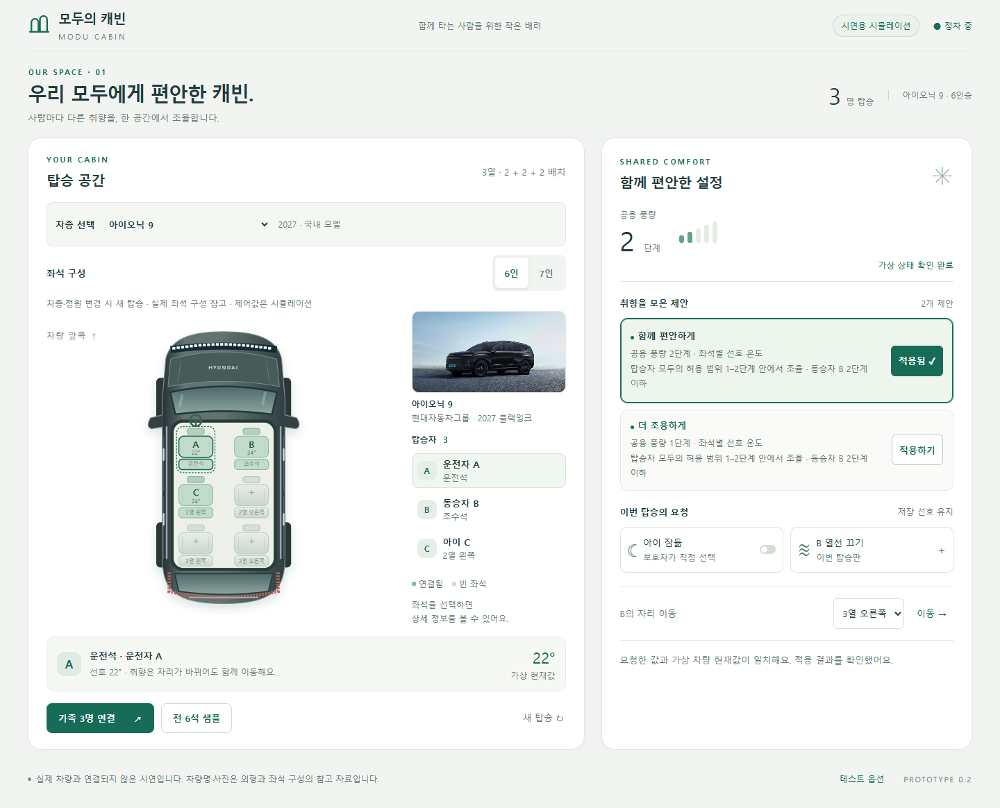

# 모두의 캐빈

함께 탄 사람들의 취향을 좌석에 연결하고, 공용 공조 설정을 함께 조율하는 시연용 프로토타입입니다.

**현재 차량 상태는 시뮬레이션입니다. 실제 Pleos SDK나 실제 차량에는 연결하지 않습니다.** 브라우저 샘플과 Android 에뮬레이터에서 설치·실행한 release APK를 제공합니다. 음성 인식·학습 AI·실차 제어는 이번 샘플 범위에 포함되지 않습니다.



## 바로 확인하기

- [브라우저에서 시연하기](https://moducabinlab.github.io/modu-cabin/)
- [시연 영상·세로 숏폼·APK 다운로드](https://github.com/ModuCabinLab/modu-cabin/releases/tag/v0.3.0-submission)
- [전체 소스코드 ZIP](https://github.com/ModuCabinLab/modu-cabin/archive/refs/heads/main.zip)
- [제출용 release APK](apk/ModuCabin_ModuCabin_release.apk)

다운로드한 소스의 `web/index.html`을 더블클릭하면 인터넷 연결 없이 실행할 수 있습니다. 별도 설치나 API 키가 필요하지 않습니다. 휴대전화 화면에서는 아래로 스크롤해 설정 패널을 조작합니다.

## APK 설치와 실행 환경

`apk/ModuCabin_ModuCabin_release.apk`는 `io.moducabin.demo`, versionCode 4 / `0.3.0-submission`인 비디버그 release 빌드입니다. 참가자 실명 대신 프로젝트명으로 만든 별도 인증서로 서명했습니다. Android 9(API 28) 이상에서 설치할 수 있으며 가로 화면 태블릿용입니다.

```sh
adb install -r apk/ModuCabin_ModuCabin_release.apk
adb shell am start -W -n io.moducabin.demo/.MainActivity
```

기존 debug APK와는 서명키가 달라 덮어쓰기가 되지 않습니다. 기존 시연 앱이 설치되어 있다면 제거한 뒤 이 APK를 설치합니다. 앱은 가상 프로필만 사용하며 영구 저장을 하지 않습니다.

- 확인 환경: Android Emulator 37.2.13, AOSP Android 14 / API 34 x86_64, WebView 113, Windows WHPX.
- 화면: 1600×1000px, 160dpi(1600×1000dp), 가로 방향. 시스템 표시줄을 제외한 앱 영역은 더 작습니다.
- 확인 동작: 설치·실행, 사진·좌석 표시, 가족 연결·설정 적용, 수면 요청, 자리 이동, 명령 실패 표시, 주행 잠금, 백그라운드 복귀·재실행.
- **Pleos Connect Emulator 사용 버전: 해당 없음(미검증).** 위 결과는 일반 Android 환경의 실제 실행 결과이며, Pleos 차량 서비스 연동 결과가 아닙니다.

[Android 실행 증거](docs/ANDROID_RUNTIME.md)와 [APK 정적 검사](docs/APK_VERIFICATION.txt)를 제공합니다. 1차 프로토타입 제출 범위이며, 2차 PT에 필요한 Pleos 실행·SDK 연결은 [후속 작업](android/PLEOS_NEXT_STEPS.md)으로 구분합니다.

## 시연 순서

1. **차종·좌석 구성**: 아이오닉 5(5인), 아이오닉 9(6·7인), 팰리세이드(7·9인)를 선택합니다. 변경하면 새 탑승으로 시작합니다. **전 좌석 샘플**은 정원에 맞춰 A~I 프로필을 연결합니다.
2. **가족 3명 연결**: 운전자 A, 동승자 B, 아이 C를 좌석에 연결합니다.
3. **적용하기**: 공용 풍량은 세 사람의 허용 범위 안에서, 온도는 좌석별 선호에 맞게 제안합니다. 가상 현재값을 읽은 뒤 완료를 표시합니다.
4. **아이 잠듦**: 보호자가 수면 상태를 직접 선택합니다. 다시 적용하면 낮은 풍량을 확인할 수 있습니다.
5. **B 열선 끄기**: 이번 탑승의 요청을 적용합니다. 현재 열선은 0단계가 되어도 저장 선호는 1단계입니다.
6. **B의 자리 이동**: 빈 좌석을 선택해 B의 선호를 새 좌석으로 옮깁니다. 6~9인승에서는 3열도 선택할 수 있습니다. 다음 제안을 적용하면 비워진 앞좌석의 열선도 끕니다. 이 시뮬레이터의 뒷좌석 열선 제어는 미지원으로 표시하며 해당 명령을 만들지 않습니다.
7. **새 탑승**: 임시 요청을 해제합니다. 다시 가족을 연결·적용하면 저장 선호가 복원됩니다.

하단 **테스트 옵션**에서 풍량 취향 충돌, 주행 상태, 명령 실패, 현재값 읽기 불가·불일치, 수동 풍량 변경을 시험할 수 있습니다. 시연 모드는 실제 차량의 기능 지원 범위와 다를 수 있습니다.

## 현대차 모델별 좌석 배치

| 2027 국내 모델 | 정원 | 열별 배치 |
| --- | --- | --- |
| 아이오닉 5 | 5인 | 2 + 3 |
| 아이오닉 9 | 6인 / 7인 | 2 + 2 + 2 / 2 + 3 + 2 |
| 팰리세이드 | 7인 / 9인 | 2 + 2 + 3 / 3 + 3 + 3 |

모델을 바꾸면 공식 외관 사진, 직접 작성한 차량 SVG, 선택 가능한 좌석 정원이 함께 바뀝니다. 좌석을 클릭하거나 키보드로 선택하면 개인 선호와 가상 현재값을 볼 수 있습니다. 일반 캐빈은 차종과 별개로 4~8석 자유 배치를 제공합니다.

[모델·사진 출처와 표현 범위](docs/VEHICLE_REFERENCES.md)를 참고하세요. SVG는 지붕을 생략한 설명용 좌석 지도이며 정확한 차량 CAD가 아닙니다. 이 시뮬레이터의 좌석별 온도·앞좌석 열선 규칙은 실제 차종의 공조/옵션 사양을 의미하지 않습니다.

## 구현과 검증

- 공용 풍량 허용 범위의 교집합을 계산하며, 교집합이 없으면 제안과 적용을 막습니다.
- 제안과 충돌의 이유에 풍량 범위를 제한한 탑승자를 표시합니다. 읽기값이 일치한 제안에는 적용됨 표시를 붙입니다.
- gateway가 보고한 시뮬레이션 지원 범위로 명령을 만들며, 비워진 지원 좌석의 열선은 다음 적용에서 끕니다.
- 임시 요청은 프로필에 연결하고 저장 선호와 분리합니다.
- 수동 조작이나 세션 변경 이후 도착한 이전 비동기 결과를 무시합니다.
- 쓰기 응답만으로 성공 처리하지 않습니다. 현재값 불일치·읽기 불가는 별도로 표시합니다.
- 주행 상태에서는 좌석 변경과 복잡한 설정 적용을 막습니다.

Node 동작 테스트 56개와 브라우저 조작 검사를 통과했습니다. Android 래퍼 테스트 5개, release 빌드·서명·번들 파일 검사 및 AOSP 에뮬레이터 설치·실행을 확인했습니다. **Pleos SDK 통합과 실제 차량 실행은 아직 검증하지 않았습니다.** 검증 상세는 [검증 기록](docs/VALIDATION.md)을 참고하세요.

## 개발 실행

Node.js 20 이상:

```sh
npm test
npm start
```

`http://127.0.0.1:4173`으로 접속합니다. 런타임 npm 의존성은 없습니다.

브라우저 테스트·영상 재생성은 개발 도구인 Playwright, Google Chrome, FFmpeg가 추가로 필요합니다.

```sh
npm install --no-save playwright
node tools/browser-check.cjs
node tools/record-demo.cjs
```

세로 영상은 `DEMO_FORMAT=portrait` 환경 변수로 같은 녹화 스크립트를 실행합니다. 이 스크립트는 `modu-cabin-browser-demo.mp4`(가로)와 `modu-cabin-shortform.mp4`(세로)를 생성합니다. 실제 클릭과 화면을 기록하며 자막과 포인터 강조만 덧붙인 무음 영상입니다.

릴리스의 대표 영상 `modu-cabin-demo.mp4`는 별도로 제공받은 117.81초 편집 영상입니다. AI 연출 장면에는 표시가 있으며, 앱 실행 화면과 차량 제어 시뮬레이션·SDK 후속 과제를 구분합니다. 1920×1080, 30fps, 음성 트랙을 포함합니다. 최신 소스의 직접 조작 기록은 83.92초 가로 영상과 47.92초 세로 영상을 참고하세요.

대표 편집 영상의 마지막에 표시된 Android 실행 예정 문구는 영상 제작 당시 상태입니다. 이후 수행한 release APK의 실제 설치·실행 결과는 위 Android 실행 증거에 별도로 기록했습니다.

`modu-cabin-android-runtime.mp4`는 최종 release APK를 Android 에뮬레이터에서 직접 조작한 31.20초 무음 실행 녹화입니다.

Android 빌드는 [Android 안내](android/README.md), 실제 SDK 연결 후속 작업은 [Pleos 연동 계획](android/PLEOS_NEXT_STEPS.md)을 참고하세요.

## 소스 구성

| 경로 | 내용 |
| --- | --- |
| `web/` | 실행 화면, 규칙 엔진, 가상 차량 gateway |
| `tests/` | 규칙·세션·비동기 취소 테스트 |
| `android/` | 로컬 웹 파일을 담는 Kotlin Android 앱 |
| `apk/` | 설치·실행 검증한 제출용 서명 APK |
| `tools/` | 로컬 서버, 브라우저 검증, 영상 기록, APK 검사 |
| `docs/` | 구조·검증·시연 참고 자료 |

시연 데이터는 A~I 가상 프로필입니다. 실제 참가자 정보·연락처·서명·키는 포함하지 않습니다. AI 개발 도구의 도움을 받아 작성한 초기 샘플이며, 규칙 엔진의 동작을 학습 AI 성능으로 주장하지 않습니다.

[Claude 검토용 복사 프롬프트와 링크](docs/CLAUDE_REVIEW_PROMPT.txt)도 제공합니다.
