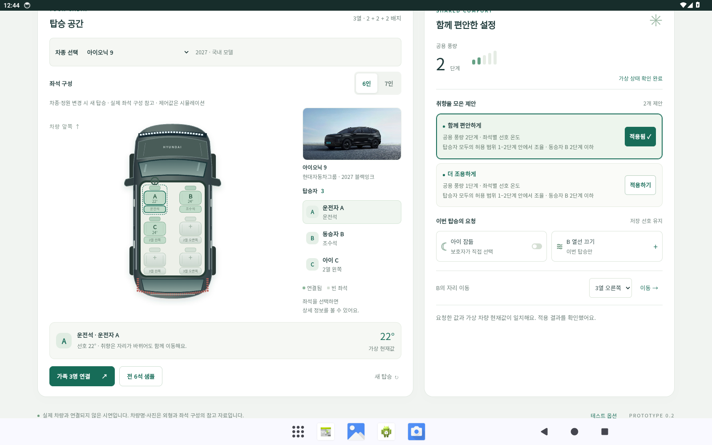
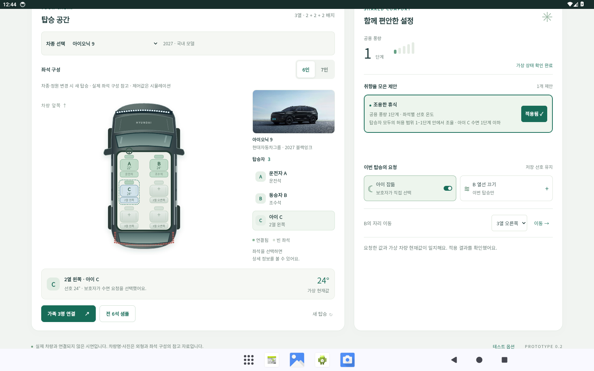
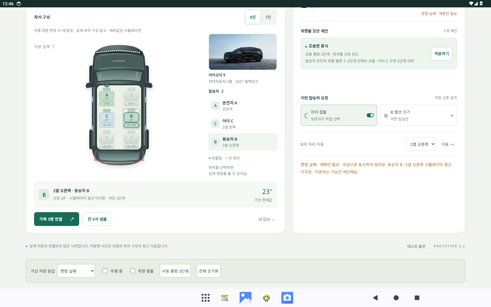

# release APK 실제 실행 확인

2026-11-13에 제출용 APK를 일반 Android 에뮬레이터에 설치하고 실제 UI를 눌러 확인했습니다. **Pleos 에뮬레이터나 실제 차량에서 수행한 검사가 아닙니다.** 차량 제어는 앱 안의 시뮬레이션입니다.

## 대상과 환경

| 항목 | 값 |
| --- | --- |
| APK | `apk/ModuCabin_ModuCabin_release.apk` |
| 패키지 / 버전 | `io.moducabin.demo` / code 4, `0.3.0-submission` |
| APK SHA-256 | `538a722f5739f80b2536ec3981ebecfb063529749947d0758b28f81832dd2696` |
| 빌드 / 서명 | non-debuggable release / 프로젝트명 인증서, v3 검증 |
| Android | AOSP Android 14, API 34, x86_64 |
| 에뮬레이터 | Android Emulator 37.2.13, Windows WHPX |
| 화면 | 1600×1000px, 160dpi = 1600×1000dp, 가로 방향 |
| WebView | 113.0.5672.136 |
| Pleos Connect Emulator | 사용하지 않음 / 미검증 |

ADB로 APK를 설치하고 `am start -W`로 Activity를 시작했습니다. 조작은 ADB 입력과 UIAutomator의 현재 화면 노드를 사용했습니다. WebView 디버깅·JavaScript 주입으로 앱 상태를 바꾸지 않았습니다. 번들 HTML/CSS/JS 4개와 JPEG 3개는 저장소의 `web/` 파일과 모두 같은 바이트입니다.

## 확인한 결과

| 실제 조작 | 관찰 결과 |
| --- | --- |
| 설치 후 시작 | Activity 표시, 로컬 차량 사진과 좌석 UI 정상 표시 |
| 가족 3명 연결 → 적용 | 가상 공용 풍량 3→2, 현재값 확인 완료·적용됨 표시 |
| 아이 잠듦 → 적용 | 가상 공용 풍량 1, 수면 요청 반영 |
| B 자리 이동 | 2열 오른쪽으로 이동, 열선 미지원 안내 |
| 명령 실패 주입 → 적용 | 성공으로 표시하지 않고 실패 안내 |
| 주행 상태 선택 | 좌석 변경·복잡한 설정 조작 비활성화 |
| HOME → 앱 복귀 | 현재 시연 상태 유지 |
| 강제 종료 → 재시작 | 초기 시연 상태로 시작 |
| 아이오닉 5·팰리세이드 선택 | 해당 차량 사진과 좌석 화면 표시, 팰리세이드 9석 구성 확인 |

세부 검사 13개가 통과했습니다. 에뮬레이터에서 설치된 APK를 다시 읽어 제출 파일과 SHA-256이 같음을 확인했습니다. 앱 로그에서 fatal/uncaught 표시는 발견되지 않았습니다. [기계 판독 결과](runtime/runtime-verification.json)의 화면·UI 계층 파일과 원본 녹화는 릴리스의 `modu-cabin-android-evidence.zip`에 같은 이름으로 포함합니다.

초기 에뮬레이터 기동 때 Windows qemu 프로세스가 종료되어 새 세션으로 다시 시작했습니다. 이후 세션에서 위 검사를 완료했습니다. 고정 가로 화면에 대한 Lint 경고 1건이 있으며 다른 폼팩터·물리 기기는 검증하지 않았습니다.

## 화면 증거

Android 상태·탐색 표시줄을 포함한 실제 에뮬레이터 화면입니다. 페이지를 조작하기 위해 스크롤한 상태이므로 일부 상단 내용은 화면 밖에 있습니다.

가족 설정 적용 후 가상 현재값 확인:

수면 요청 적용 후 풍량 1:

주입한 명령 실패 표시:

## 실행 녹화와 재검사

[제출 릴리스](https://github.com/ModuCabinLab/modu-cabin/releases/tag/v0.3.0-submission)의 `modu-cabin-android-runtime.mp4`는 이 release APK의 실제 Android 화면 녹화입니다. 31.20초, 1280×800, H.264 30fps, 무음이며 가족 연결·적용·수면 요청·재적용을 보여 줍니다. 재생 호환성을 위해 프레임률과 컨테이너를 정리했으며 앱 화면 내용은 바꾸지 않았습니다.

설치 명령과 빌드 방법은 [Android 안내](../android/README.md), 정적 검사 결과는 [APK_VERIFICATION.txt](APK_VERIFICATION.txt), Pleos 연결 계획은 [후속 작업](../android/PLEOS_NEXT_STEPS.md)을 참고하세요.
